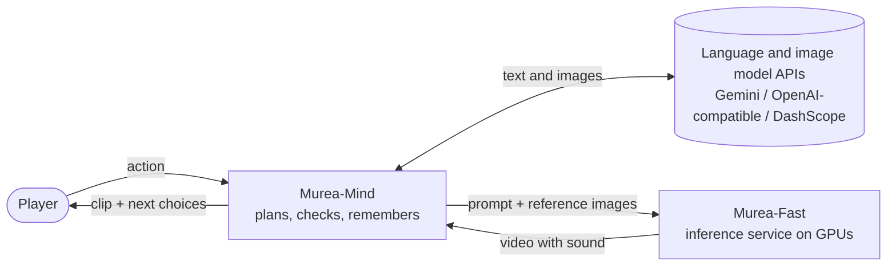

<div align="center">

<a href="https://murea.ai/"></a>

**Type what you do, and the world films it.**

Open-source video generation with synchronized sound from text and reference images,
and an agent that turns your actions into a continuing, filmed story.

[](https://murea.ai/)
[](https://murea.ai/page/paper/InWorld-technical-report.pdf)
[](https://github.com/Murea-Labs/InWorld)
[](https://huggingface.co/MureaLabs/InWorld)
[](LICENSE)

**English** | [中文](README_zh.md)

🎬 [Demo](#demo) · 🚀 [Quick start](#quick-start) · 🧭 [Guides](#where-to-start) · 📚 [Citation](#citation) · ✉️ [Contact](mailto:labs@murea.ai)

</div>

<a name="demo"></a>

## 🎬 Demo

**Text-driven storytelling with Murea-InWorld** · 2 min 19 s ·
[Download the original-quality video](docs/assets/murea-inworld-demo.mp4?raw=true)

https://github.com/user-attachments/assets/2617c0f3-ded2-4a8f-81bb-b77095c92b0e

> [!NOTE]
> The Murea-Fast weights are available on [Hugging Face](https://huggingface.co/MureaLabs/InWorld).
> Download `murea-fast.safetensors` and follow the [deployment guide](inference/docs/deployment.md)
> to verify the checkpoint and set up the LTX-2.5 base components.

<a name="abstract"></a>

## 📄 Abstract

Adapted from our [technical report](https://murea.ai/page/paper/InWorld-technical-report.pdf).
The report evaluates Murea-Pro and Murea-Fast; this repository provides Murea-Mind and the
Murea-Fast inference service.

Interactive world models aim to simulate environments that evolve under user actions while
retaining the consequences of past interactions. Extending such worlds to sight and sound
requires persistent entities, changing scene states, and local audiovisual dynamics to
remain coherent across turns. This paper presents Murea-InWorld, an interactive audiovisual
world model that couples explicit world-state management with neural audiovisual generation.
Its world agent, Murea-Mind, maintains characters, objects, locations, and narrative progress,
interprets user actions in context, and compiles planned events into generation conditions.
Observations of generated frames inform subsequent planning and selected state updates,
closing the interaction loop.

Its audiovisual generator, Murea, realizes these events through Omni-Reference Generation,
using visual references to anchor entity appearance and structured descriptions to specify
actions and dialogue. Streaming generation uses modality-specific histories, with longer
audio context for unfinished utterances. Degraded-history training prepares the model for
imperfect rollout context, while sequential MeanFlow and distribution matching distillation
enable few-step synthesis. Branching histories support alternative continuations, and co-op
interaction brings multiple participants' actions into the same world.

We evaluate the generation components in complementary configurations. Murea-Pro achieves
an Overall score of **81.13 on WBench Full-289**, the highest among the compared systems.
Murea-Fast achieves a Total score of **64.98 on OpenS2V-Eval** and an aggregate score of
**69.9 on OS2V-Pro**, an extended evaluation of reference fidelity, attribute binding,
rendering quality, and audio. Murea-Pro and Murea-Fast achieve state-of-the-art performance
on their respective benchmarks, and both models surpass most evaluated commercial systems
in their respective evaluations.

<a name="news"></a>

## 📣 News

- **2026-10-17** · Watch the [text-driven storytelling demo](#demo).
- **2026-10-17** · [Murea-Fast weights](https://huggingface.co/MureaLabs/InWorld/blob/main/murea-fast.safetensors)
  are now available on Hugging Face.
- **2026-10** · First open-source release: the Murea-Fast inference service and Murea-Mind,
  with documentation in English and Chinese.

<a name="highlights"></a>

## ✨ Highlights

- **Video with sound from several references.** Bind people, objects and a place as ordered
  reference images, refer to them in the prompt, and get 1280×704, 24 fps video with
  synchronized audio, spoken lines included.
- **Clips that keep going.** A continuation picks up from the last 17 frames of a clip, with
  the same people and the same scene.
- **Quick to film.** 8-step distilled sampling: a 5-second clip takes about 17 s on four H20
  GPUs with sequence parallelism.
- **An agent that remembers in pictures.** Every character, object and place is a reference
  image with a locked description, so a story keeps its cast and its places from clip to
  clip. Each beat is planned, checked, filmed and then reviewed against the real frames, and
  every step is visible in the web UI.
- **Play together.** In co-op rooms 2–4 players, people or AI teammates, each bring a
  character, and every round is filmed as one shared clip.

<a name="what-you-can-do"></a>

## 🎮 What you can do

<table>
  <tr>
    <td width="50%" valign="top">
      <!--  -->
      <b>🖼️ Film a scene from references</b><br>
      Two characters and a place, one prompt, a clip with dialogue and sound.
      <a href="inference/README.md#multi-reference-generation">Murea-Fast</a>
    </td>
    <td width="50%" valign="top">
      <!--  -->
      <b>🔄 Continue a clip</b><br>
      Pick up from the last frames and keep the action going.
      <a href="inference/README.md#continuation">Murea-Fast</a>
    </td>
  </tr>
  <tr>
    <td width="50%" valign="top">
      <!--  -->
      <b>🎭 Play a story</b><br>
      Type an action, watch it happen, choose what comes next.
      <a href="agent/README.md#quick-start">Murea-Mind</a>
    </td>
    <td width="50%" valign="top">
      <!--  -->
      <b>👥 Play with friends</b><br>
      A shared room, one clip per round, with optional AI teammates.
      <a href="agent/README.md#co-op-mode">Co-op mode</a>
    </td>
  </tr>
</table>

<a name="how-it-fits-together"></a>

## 🧩 How it fits together



The two parts talk over a documented [HTTP API](inference/docs/api.md), so the service can
run on another machine or behind an SSH tunnel, and other clients can use it too.

<a name="where-to-start"></a>

## 🧭 Where to start

| I want to… | Start here |
| --- | --- |
| Play a story in the browser | [Murea-Mind quick start](agent/README.md#quick-start) |
| Play with friends | [Co-op mode](agent/README.md#co-op-mode) |
| Generate or continue a clip from the command line | [Murea-Fast quick start](inference/README.md#quick-start) |
| Call the model from my own code | [API reference](inference/docs/api.md) |
| Run the service on my GPUs | [Deployment](inference/docs/deployment.md) |
| Know how fast it is and how much memory it needs | [Performance](inference/docs/performance.md) |
| Contribute | [CONTRIBUTING.md](CONTRIBUTING.md) |

<a name="components"></a>

## ⚙️ Components

| | [Murea-Fast](inference/README.md) | [Murea-Mind](agent/README.md) |
| --- | --- | --- |
| What it is | Inference service for an 8-step distilled derivative of LTX-2.5, on a pinned SGLang | Web app and Python package: a language-model director, deterministic checks, world memory and a critic |
| Runs on | Linux and NVIDIA GPUs with CUDA. Verified on one H20 and on four H20s | Any machine with Python 3.12; needs a language and image model API key and a Murea-Fast service |
| Interface | HTTP API, command line | Web UI, terminal, Python API |

<a name="quick-start"></a>

## 🚀 Quick start

**1. Start Murea-Fast on a GPU machine.** Install the environment and the LTX-2.5 base
components as described in [Deployment](inference/docs/deployment.md), download the
[murea-fast.safetensors checkpoint](https://huggingface.co/MureaLabs/InWorld/blob/main/murea-fast.safetensors),
and set the four paths in `inference/configs/single-gpu.json`. Set `checkpoint` to the
absolute path of the downloaded file. Then:

```bash
cd inference
bash scripts/murea-fast prepare --config configs/single-gpu.json
bash scripts/murea-fast start --config configs/single-gpu.json
curl --fail http://127.0.0.1:30260/health
```

**2. Run Murea-Mind on any machine.** It needs [uv](https://docs.astral.sh/uv/) and a key
for text and images (Gemini, any OpenAI-compatible server, or DashScope):

```bash
git clone https://github.com/Murea-Labs/InWorld.git Murea-InWorld && cd Murea-InWorld/agent
cp .env.example .env          # set GEMINI_API_KEY and MUREA_URL=http://<gpu-host>:30260
./run.sh                      # then open http://127.0.0.1:8080
```

See the [Murea-Mind README](agent/README.md#quick-start) for other providers, Docker and
SSH tunnels.

<a name="repository-layout"></a>

## 🗂️ Repository layout

```text
Murea-InWorld/
├── LICENSE
├── CONTRIBUTING.md
├── SECURITY.md
├── inference/            Murea-Fast inference service
│   ├── configs/          service configurations and an example request
│   ├── docs/             deployment, API, performance, provenance
│   ├── scripts/          CLI wrapper, connector merge, acceptance run
│   ├── src/murea_fast/   launcher and client
│   ├── tests/
│   └── vendor/sglang/    pinned SGLang with the model implementation
└── agent/                Murea-Mind
    ├── murea_agent/      the agent (Python package)
    ├── app/              FastAPI server
    ├── frontend/         React UI (prebuilt in frontend/dist)
    ├── docs/             co-op mode design notes
    └── tests/
```

<a name="security"></a>

## 🔒 Security

Neither the inference service nor the agent has authentication. Read [SECURITY.md](SECURITY.md)
before deploying them on a shared network.

<a name="contributing"></a>

## 🤝 Contributing

See [CONTRIBUTING.md](CONTRIBUTING.md) for the checks each part needs before a pull request.

<a name="license"></a>

## 📜 License

The code is released under the [Apache License 2.0](LICENSE). The vendored SGLang in
`inference/vendor/` keeps its own copyright and license notices, including the files it
carries under MIT and BSD-3-Clause. The Murea-Fast model weights are a derivative of LTX-2.5
and are governed by the
[LTX-2.x Community License Agreement](https://github.com/Lightricks/LTX-2/blob/main/LICENSE-2_x);
see [Provenance](inference/docs/provenance.md) for details. The agent calls third-party
language and image model APIs, which have their own terms.

<a name="citation"></a>

## 📚 Citation

```bibtex
@misc{murea_inworld2026,
  title        = {InWorld: From Imagination to Living Worlds with Agents and Fast Video Generation},
  author       = {{Murea Labs}},
  year         = {2026},
  url          = {https://murea.ai/page/paper/InWorld-technical-report.pdf}
}
```

<a name="contact"></a>

## ✉️ Contact

Email: [labs@murea.ai](mailto:labs@murea.ai)
