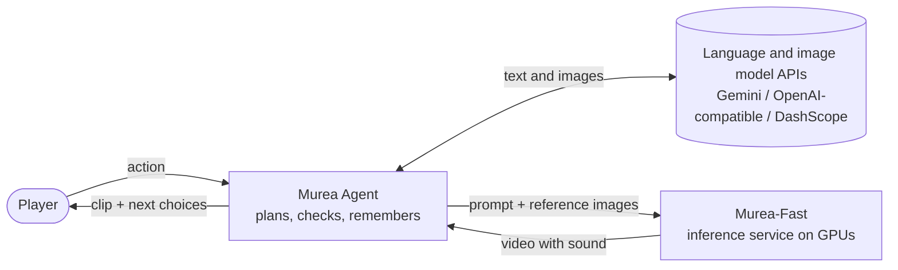

<div align="center">

# InWorld

**Type what you do, and the world films it.**

Open-source video generation with synchronized sound from text and reference images,
and an agent that turns your actions into a continuing, filmed story.

[](LICENSE)
[](https://github.com/sjsjhsu/InWorld/actions/workflows/agent.yml)
[](https://github.com/sjsjhsu/InWorld/actions/workflows/inference.yml)
[](#news)

**English** | [中文](README_zh.md)

<!-- Teaser video goes here (an MP4 uploaded to GitHub, or a GIF in docs/assets/). -->

</div>

> [!NOTE]
> The Murea-Fast weights are not published yet. They will be released on Hugging Face. Until
> then the inference service cannot be started, so the agent has no video model to film with.
> The code, the documentation and the offline tests are available now.

## News

- **2026-10** · First open-source release: the Murea-Fast inference service and Murea Agent,
  with documentation in English and Chinese.
- **Coming soon** · Murea-Fast weights on Hugging Face, and demo videos.

## Highlights

- **Video with sound from several references.** Bind people, objects and a place as ordered
  reference images, refer to them in the prompt, and get 1280×704, 24 fps video with
  synchronized audio, spoken lines included.
- **Clips that keep going.** A continuation picks up from the last 17 frames of a clip, with
  the same people and the same scene.
- **Quick to film.** 8-step distilled sampling: a 5-second clip takes about 17 s on four H20
  GPUs with sequence parallelism.
- **An agent that remembers in pictures.** Every character, object and place is a reference
  image with a locked description, so a story keeps its cast and its places from clip to
  clip. Each beat is planned, checked, filmed and then reviewed against the real frames, and
  every step is visible in the web UI.
- **Play together.** In co-op rooms 2–4 players, people or AI teammates, each bring a
  character, and every round is filmed as one shared clip.

## What you can do

<table>
  <tr>
    <td width="50%" valign="top">
      <!--  -->
      <b>Film a scene from references</b><br>
      Two characters and a place, one prompt, a clip with dialogue and sound.
      <a href="inference/README.md#multi-reference-generation">Murea-Fast</a>
    </td>
    <td width="50%" valign="top">
      <!--  -->
      <b>Continue a clip</b><br>
      Pick up from the last frames and keep the action going.
      <a href="inference/README.md#continuation">Murea-Fast</a>
    </td>
  </tr>
  <tr>
    <td width="50%" valign="top">
      <!--  -->
      <b>Play a story</b><br>
      Type an action, watch it happen, choose what comes next.
      <a href="agent/README.md#quick-start">Murea Agent</a>
    </td>
    <td width="50%" valign="top">
      <!--  -->
      <b>Play with friends</b><br>
      A shared room, one clip per round, with optional AI teammates.
      <a href="agent/README.md#co-op-mode">Co-op mode</a>
    </td>
  </tr>
</table>

## How it fits together



The two parts talk over a documented [HTTP API](inference/docs/api.md), so the service can
run on another machine or behind an SSH tunnel, and other clients can use it too.

## Where to start

| I want to… | Start here |
| --- | --- |
| Play a story in the browser | [Murea Agent quick start](agent/README.md#quick-start) |
| Play with friends | [Co-op mode](agent/README.md#co-op-mode) |
| Generate or continue a clip from the command line | [Murea-Fast quick start](inference/README.md#quick-start) |
| Call the model from my own code | [API reference](inference/docs/api.md) |
| Run the service on my GPUs | [Deployment](inference/docs/deployment.md) |
| Know how fast it is and how much memory it needs | [Performance](inference/docs/performance.md) |
| Contribute | [CONTRIBUTING.md](CONTRIBUTING.md) |

## Components

| | [Murea-Fast](inference/README.md) | [Murea Agent](agent/README.md) |
| --- | --- | --- |
| What it is | Inference service for an 8-step distilled derivative of LTX-2.5, on a pinned SGLang | Web app and Python package: a language-model director, deterministic checks, world memory and a critic |
| Runs on | Linux and NVIDIA GPUs with CUDA. Verified on one H20 and on four H20s | Any machine with Python 3.12; needs a language and image model API key and a Murea-Fast service |
| Interface | HTTP API, command line | Web UI, terminal, Python API |

## Quick start

These steps need the Murea-Fast weights, which are [not published yet](#news).

**1. Start Murea-Fast on a GPU machine.** Install the environment and the LTX-2.5 base
components as described in [Deployment](inference/docs/deployment.md), download the
checkpoint, and set the four paths in `inference/configs/single-gpu.json`. Then:

```bash
cd inference
bash scripts/murea-fast prepare --config configs/single-gpu.json
bash scripts/murea-fast start --config configs/single-gpu.json
curl --fail http://127.0.0.1:30260/health
```

**2. Run Murea Agent on any machine.** It needs [uv](https://docs.astral.sh/uv/) and a key
for text and images (Gemini, any OpenAI-compatible server, or DashScope):

```bash
git clone https://github.com/sjsjhsu/InWorld && cd InWorld/agent
cp .env.example .env          # set GEMINI_API_KEY and MUREA_URL=http://<gpu-host>:30260
./run.sh                      # then open http://127.0.0.1:8080
```

See the [Murea Agent README](agent/README.md#quick-start) for other providers, Docker and
SSH tunnels.

## Repository layout

```text
InWorld/
├── LICENSE
├── CONTRIBUTING.md
├── SECURITY.md
├── inference/            Murea-Fast inference service
│   ├── configs/          service configurations and an example request
│   ├── docs/             deployment, API, performance, provenance
│   ├── scripts/          CLI wrapper, connector merge, acceptance run
│   ├── src/murea_fast/   launcher and client
│   ├── tests/
│   └── vendor/sglang/    pinned SGLang with the model implementation
└── agent/                Murea Agent
    ├── murea_agent/      the agent (Python package)
    ├── app/              FastAPI server
    ├── frontend/         React UI (prebuilt in frontend/dist)
    ├── docs/             co-op mode design notes
    └── tests/
```

## Security

Neither the inference service nor the agent has authentication. Read [SECURITY.md](SECURITY.md)
before deploying them on a shared network.

## Contributing

See [CONTRIBUTING.md](CONTRIBUTING.md) for the checks each part needs before a pull request.

## Acknowledgements

Murea-Fast is fine-tuned and distilled from [LTX-2.5](https://github.com/Lightricks/LTX-2)
by Lightricks and is served with [SGLang](https://github.com/sgl-project/sglang). The
agent's optional narration voice uses [OmniVoice](https://github.com/k2-fsa/OmniVoice).
InWorld is not affiliated with or endorsed by Lightricks.

## License

The code is released under the [Apache License 2.0](LICENSE). The vendored SGLang in
`inference/vendor/` keeps its own copyright and license notices, including the files it
carries under MIT and BSD-3-Clause. The Murea-Fast model weights are a derivative of LTX-2.5
and are governed by the
[LTX-2.x Community License Agreement](https://github.com/Lightricks/LTX-2/blob/main/LICENSE-2_x);
see [Provenance](inference/docs/provenance.md) for details. The agent calls third-party
language and image model APIs, which have their own terms.

## Citation

```bibtex
@misc{inworld2026,
  title        = {InWorld: Multi-Reference Audio-Video Generation and an Open-World Video Agent},
  author       = {{The InWorld Authors}},
  year         = {2026},
  howpublished = {\url{https://github.com/sjsjhsu/InWorld}}
}
```
