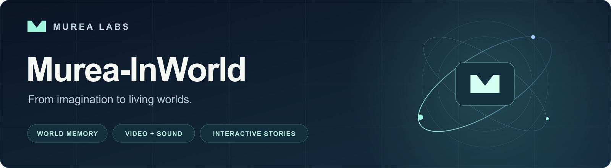
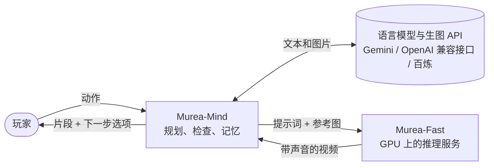

<div align="center">

<a href="https://murea.ai/"></a>

**说出你想做什么，世界替你拍出来。**

开源的视频生成系统：根据文本和参考图生成带同步音频的视频，
并提供一个 Agent，把你的每一步行动拍成连续的故事。

[](https://murea.ai/)
[](https://murea.ai/page/paper/InWorld-technical-report.pdf)
[](https://github.com/Murea-Labs/InWorld)
[](https://huggingface.co/MureaLabs/InWorld)
[](LICENSE)

[English](README.md) | **中文**

🎬 [演示](#演示视频) · 🚀 [快速上手](#快速上手) · 🧭 [使用指南](#从哪里开始) · 📚 [引用](#引用) · ✉️ [联系我们](mailto:labs@murea.ai)

</div>

<a name="演示视频"></a>

## 🎬 演示视频

**Murea-InWorld 文字驱动剧情演示** · 2 分 19 秒 ·
[下载原画质视频](docs/assets/murea-inworld-demo.mp4?raw=true)

https://github.com/user-attachments/assets/2617c0f3-ded2-4a8f-81bb-b77095c92b0e

> [!NOTE]
> Murea-Fast 权重已在 [Hugging Face](https://huggingface.co/MureaLabs/InWorld) 发布。
> 下载 `murea-fast.safetensors`，并按[部署说明](inference/docs/deployment_zh.md)
> 校验权重、准备 LTX-2.5 基础组件。

<a name="摘要"></a>

## 📄 摘要

以下摘要译自我们的[技术报告](https://murea.ai/page/paper/InWorld-technical-report.pdf)，项目名称与本仓库保持一致。
报告评测了 Murea-Pro 和 Murea-Fast；本仓库提供 Murea-Mind 与 Murea-Fast 推理服务。

交互式世界模型旨在模拟随用户行动而演化的环境，同时保留过去交互带来的影响。将这样的世界扩展到视觉与听觉，
需要持续存在的实体、不断变化的场景状态以及局部视听动态在多轮交互中保持一致。
本文提出 Murea-InWorld，一种将显式世界状态管理与神经网络视听生成相结合的交互式视听世界模型。
其世界智能体 Murea-Mind 维护角色、物体、地点与叙事进展，结合上下文理解用户行动，并将规划的事件编译为生成条件。
对生成帧的观察为后续规划和部分状态更新提供依据，从而形成交互闭环。

视听生成器 Murea 通过全参考生成（Omni-Reference Generation）实现这些事件：使用视觉参考固定实体外观，
并通过结构化描述指定动作与对话。流式生成采用各模态专属的历史上下文，并为尚未结束的话语保留更长的音频上下文。
基于退化历史的训练使模型能够适应不完美的滚动生成上下文，而依次进行的 MeanFlow 蒸馏与分布匹配蒸馏则实现了少步合成。
分支历史支持不同的后续发展，多人协作交互则将多位参与者的行动汇入同一个世界。

我们在互补配置下评测生成组件。Murea-Pro 在 **WBench Full-289 上取得 81.13 的 Overall 分数**，
在参与比较的系统中排名最高。Murea-Fast 在 **OpenS2V-Eval 上取得 64.98 的 Total 分数**，
并在 **OS2V-Pro 上取得 69.9 的综合分数**；OS2V-Pro 是针对参考保真度、属性绑定、渲染质量和音频的扩展评测。
Murea-Pro 和 Murea-Fast 在各自的基准上均达到最先进水平，且两者在各自评测中均超过大多数参评的商业系统。

<a name="动态"></a>

## 📣 动态

- **2026-10-17** · [文字驱动剧情演示视频](#演示视频)已发布。
- **2026-10-17** · [Murea-Fast 权重](https://huggingface.co/MureaLabs/InWorld/blob/main/murea-fast.safetensors)
  已在 Hugging Face 发布。
- **2026-10** · 首次开源：Murea-Fast 推理服务与 Murea-Mind，文档提供中英文两版。

<a name="亮点"></a>

## ✨ 亮点

- **多张参考图生成带声音的视频。** 把人物、物件和地点按顺序作为参考图传入，在提示词里引用它们，
  生成 1280×704、24 fps、音画同步的视频，台词也一起生成。
- **接着拍。** 续写从上一段的最后 17 帧接下去，人物和场景保持不变。
- **出片快。** 8 步蒸馏采样：4 张 H20 做序列并行时，5 秒片段约 17 秒拍完。
- **用图片记住世界的 Agent。** 每个角色、物件和地点都是一张参考图加一段锁定的描述，
  所以故事从一段到下一段，人物和场景都不会变样。每一拍先规划、再检查、然后拍摄，最后对照真实画面复核，
  每一步都能在网页界面里看到。
- **一起玩。** 双人模式下 2–4 位玩家（真人或 AI 队友）各带一个角色，每一轮拍成一段共享视频。

<a name="能做什么"></a>

## 🎮 能做什么

<table>
  <tr>
    <td width="50%" valign="top">
      <!--  -->
      <b>🖼️ 用参考图拍一场戏</b><br>
      两个角色加一个地点，一句提示词，拍出带台词和声音的片段。
      <a href="inference/README_zh.md#多参考图生成">Murea-Fast</a>
    </td>
    <td width="50%" valign="top">
      <!--  -->
      <b>🔄 接着拍</b><br>
      从上一段的最后几帧接下去，让动作继续进行。
      <a href="inference/README_zh.md#续写">Murea-Fast</a>
    </td>
  </tr>
  <tr>
    <td width="50%" valign="top">
      <!--  -->
      <b>🎭 玩一个故事</b><br>
      输入一个动作，看它发生，再选下一步。
      <a href="agent/README_zh.md#快速开始">Murea-Mind</a>
    </td>
    <td width="50%" valign="top">
      <!--  -->
      <b>👥 和朋友一起玩</b><br>
      共用一个房间，每轮一段视频，还可以加 AI 队友。
      <a href="agent/README_zh.md#双人模式">双人模式</a>
    </td>
  </tr>
</table>

<a name="整体结构"></a>

## 🧩 整体结构



两部分通过有文档的 [HTTP API](inference/docs/api_zh.md) 通信，所以推理服务可以在另一台机器上运行，
或通过 SSH 隧道访问，其他客户端也可以直接调用。

<a name="从哪里开始"></a>

## 🧭 从哪里开始

| 我想… | 从这里开始 |
| --- | --- |
| 在浏览器里玩一个故事 | [Murea-Mind 快速开始](agent/README_zh.md#快速开始) |
| 和朋友一起玩 | [双人模式](agent/README_zh.md#双人模式) |
| 在命令行里生成或续写一段视频 | [Murea-Fast 快速开始](inference/README_zh.md#快速开始) |
| 在自己的代码里调用模型 | [API 文档](inference/docs/api_zh.md) |
| 在自己的 GPU 上部署服务 | [部署说明](inference/docs/deployment_zh.md) |
| 了解速度和显存占用 | [性能](inference/docs/performance_zh.md) |
| 参与贡献 | [CONTRIBUTING_zh.md](CONTRIBUTING_zh.md) |

<a name="组成部分"></a>

## ⚙️ 组成部分

| | [Murea-Fast](inference/README_zh.md) | [Murea-Mind](agent/README_zh.md) |
| --- | --- | --- |
| 是什么 | 推理服务，运行一个由 LTX-2.5 衍生、8 步蒸馏的模型，基于固定版本的 SGLang | 网页应用和 Python 包：语言模型导演、确定性检查、世界记忆和评审 |
| 运行环境 | Linux 与支持 CUDA 的 NVIDIA GPU。已在单张和 4 张 H20 上验证 | 任意装有 Python 3.12 的机器；需要语言模型与生图的 API key，以及一个 Murea-Fast 服务 |
| 使用方式 | HTTP API、命令行 | 网页界面、终端、Python API |

<a name="快速上手"></a>

## 🚀 快速上手

**1. 在 GPU 机器上启动 Murea-Fast。** 按[部署说明](inference/docs/deployment_zh.md)安装环境和 LTX-2.5
基础组件，下载 [murea-fast.safetensors 权重](https://huggingface.co/MureaLabs/InWorld/blob/main/murea-fast.safetensors)，
并填好 `inference/configs/single-gpu.json` 里的四个路径。`checkpoint` 应指向下载文件的绝对路径。然后：

```bash
cd inference
bash scripts/murea-fast prepare --config configs/single-gpu.json
bash scripts/murea-fast start --config configs/single-gpu.json
curl --fail http://127.0.0.1:30260/health
```

**2. 在任意机器上运行 Murea-Mind。** 需要 [uv](https://docs.astral.sh/uv/)，以及一个文本和出图用的 key
（Gemini、任何 OpenAI 兼容接口，或阿里云百炼）：

```bash
git clone https://github.com/Murea-Labs/InWorld.git Murea-InWorld && cd Murea-InWorld/agent
cp .env.example .env          # 填好 GEMINI_API_KEY 和 MUREA_URL=http://<GPU 主机>:30260
./run.sh                      # 然后打开 http://127.0.0.1:8080
```

换用其他模型服务商、Docker 和 SSH 隧道的用法见 [Murea-Mind README](agent/README_zh.md#快速开始)。

<a name="目录结构"></a>

## 🗂️ 目录结构

```text
Murea-InWorld/
├── LICENSE
├── CONTRIBUTING.md
├── SECURITY.md
├── inference/            Murea-Fast 推理服务
│   ├── configs/          服务配置和示例请求
│   ├── docs/             部署、API、性能、来源说明
│   ├── scripts/          命令行入口、connector 合并、端到端检查
│   ├── src/murea_fast/   启动器和客户端
│   ├── tests/
│   └── vendor/sglang/    带模型实现的固定版本 SGLang
└── agent/                Murea-Mind
    ├── murea_agent/      agent 本体（Python 包）
    ├── app/              FastAPI 服务端
    ├── frontend/         React 界面（构建产物在 frontend/dist）
    ├── docs/             双人模式设计说明
    └── tests/
```

<a name="安全"></a>

## 🔒 安全

推理服务和 Agent 都没有鉴权。部署到共享网络之前，请先阅读[安全说明](SECURITY_zh.md)。

<a name="参与贡献"></a>

## 🤝 参与贡献

提交 pull request 前各部分需要运行的检查，见 [CONTRIBUTING_zh.md](CONTRIBUTING_zh.md)。

<a name="许可证"></a>

## 📜 许可证

代码以 [Apache License 2.0](LICENSE) 发布。`inference/vendor/` 中的 SGLang 保留其自身的版权和许可证声明，
其中包括以 MIT 和 BSD-3-Clause 许可的文件。Murea-Fast 模型权重是 LTX-2.5 的衍生模型，受
[LTX-2.x Community License Agreement](https://github.com/Lightricks/LTX-2/blob/main/LICENSE-2_x)
约束，详见[来源说明](inference/docs/provenance_zh.md)。Agent 会调用第三方语言模型和图像模型 API，
这些服务另有各自的条款。

<a name="引用"></a>

## 📚 引用

```bibtex
@misc{murea_inworld2026,
  title        = {InWorld: From Imagination to Living Worlds with Agents and Fast Video Generation},
  author       = {{Murea Labs}},
  year         = {2026},
  url          = {https://murea.ai/page/paper/InWorld-technical-report.pdf}
}
```

<a name="联系方式"></a>

## ✉️ 联系方式

联系邮箱：[labs@murea.ai](mailto:labs@murea.ai)
