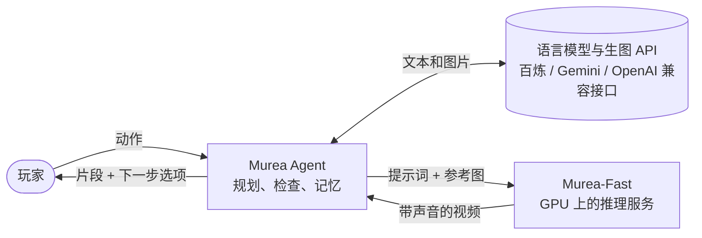

<div align="center">

# InWorld

**说出你想做什么，世界替你拍出来。**

开源的视频生成系统：根据文本和参考图生成带同步音频的视频，
并提供一个 Agent，把你的每一步行动拍成连续的故事。

[](LICENSE)
[](https://github.com/sjsjhsu/InWorld/actions/workflows/agent.yml)
[](https://github.com/sjsjhsu/InWorld/actions/workflows/inference.yml)
[](#动态)

[English](README.md) | **中文**

<!-- 预告视频放在这里（上传到 GitHub 的 MP4，或 docs/assets/ 下的 GIF）。 -->

</div>

> [!NOTE]
> Murea-Fast 模型权重尚未发布，之后会在 Hugging Face 上发布。在此之前推理服务无法启动，
> Agent 也就没有可用的视频模型。代码、文档和离线测试现在都可以使用。

## 动态

- **2026-10** · 首次开源：Murea-Fast 推理服务与 Murea Agent，文档提供中英文两版。
- **即将发布** · Murea-Fast 权重（Hugging Face）与演示视频。

## 亮点

- **多张参考图生成带声音的视频。** 把人物、物件和地点按顺序作为参考图传入，在提示词里引用它们，
  生成 1280×704、24 fps、音画同步的视频，台词也一起生成。
- **单段最长 20 秒，还能接着拍。** 续写从上一段的最后 17 帧接下去，人物和场景保持不变。
- **出片快。** 8 步蒸馏采样：4 张 H20 做序列并行时，5 秒片段约 17 秒拍完。
- **用图片记住世界的 Agent。** 每个角色、物件和地点都是一张参考图加一段锁定的描述，
  所以故事从一段到下一段，人物和场景都不会变样。每一拍先规划、再检查、然后拍摄，最后对照真实画面复核，
  每一步都能在网页界面里看到。
- **一起玩。** 双人模式下 2–4 位玩家（真人或 AI 队友）各带一个角色，每一轮拍成一段共享视频。

## 能做什么

<table>
  <tr>
    <td width="50%" valign="top">
      <!--  -->
      <b>用参考图拍一场戏</b><br>
      两个角色加一个地点，一句提示词，拍出带台词和声音的片段。
      <a href="inference/README_zh.md#多参考图生成">Murea-Fast</a>
    </td>
    <td width="50%" valign="top">
      <!--  -->
      <b>接着拍</b><br>
      从上一段的最后几帧接下去，让动作继续进行。
      <a href="inference/README_zh.md#续写">Murea-Fast</a>
    </td>
  </tr>
  <tr>
    <td width="50%" valign="top">
      <!--  -->
      <b>玩一个故事</b><br>
      输入一个动作，看它发生，再选下一步。
      <a href="agent/README_zh.md#快速开始">Murea Agent</a>
    </td>
    <td width="50%" valign="top">
      <!--  -->
      <b>和朋友一起玩</b><br>
      共用一个房间，每轮一段视频，还可以加 AI 队友。
      <a href="agent/README_zh.md#双人模式">双人模式</a>
    </td>
  </tr>
</table>

## 整体结构



两部分通过有文档的 [HTTP API](inference/docs/api_zh.md) 通信，所以推理服务可以在另一台机器上运行，
或通过 SSH 隧道访问，其他客户端也可以直接调用。

## 从哪里开始

| 我想… | 从这里开始 |
| --- | --- |
| 在浏览器里玩一个故事 | [Murea Agent 快速开始](agent/README_zh.md#快速开始) |
| 和朋友一起玩 | [双人模式](agent/README_zh.md#双人模式) |
| 在命令行里生成或续写一段视频 | [Murea-Fast 快速开始](inference/README_zh.md#快速开始) |
| 在自己的代码里调用模型 | [API 文档](inference/docs/api_zh.md) |
| 在自己的 GPU 上部署服务 | [部署说明](inference/docs/deployment_zh.md) |
| 了解速度和显存占用 | [性能](inference/docs/performance_zh.md) |
| 参与贡献 | [CONTRIBUTING_zh.md](CONTRIBUTING_zh.md) |

## 组成部分

| | [Murea-Fast](inference/README_zh.md) | [Murea Agent](agent/README_zh.md) |
| --- | --- | --- |
| 是什么 | 推理服务，运行一个由 LTX-2.5 衍生、8 步蒸馏的模型，基于固定版本的 SGLang | 网页应用和 Python 包：语言模型导演、确定性检查、世界记忆和评审 |
| 运行环境 | Linux 与支持 CUDA 的 NVIDIA GPU。已验证：单张 H20（5 秒片段），4 张 141 GB 的 H20（5–20 秒） | 任意装有 Python 3.12 的机器；需要语言模型与生图的 API key，以及一个 Murea-Fast 服务 |
| 使用方式 | HTTP API、命令行 | 网页界面、终端、Python API |

在 4 张 141 GB 的 H20 上、1280×704 的实测结果（[详情](inference/docs/performance_zh.md#片段时长)）：

| 片段时长 | 5 秒 | 10 秒 | 15 秒 | 20 秒 |
| --- | ---: | ---: | ---: | ---: |
| 推理时间 | 17.0 秒 | 34.7 秒 | 56.1 秒 | 80.8 秒 |
| 每卡峰值预留显存 | 81,486 MiB | 92,260 MiB | 103,396 MiB | 114,206 MiB |

单张 H20 上拍 5 秒片段需要 44–101 秒，取决于参考图的大小。

## 快速上手

以下步骤需要 Murea-Fast 权重，权重[尚未发布](#动态)。

**1. 在 GPU 机器上启动 Murea-Fast。** 按[部署说明](inference/docs/deployment_zh.md)安装环境和 LTX-2.5
基础组件，下载权重，并填好 `inference/configs/single-gpu.json` 里的四个路径。然后：

```bash
cd inference
bash scripts/murea-fast prepare --config configs/single-gpu.json
bash scripts/murea-fast start --config configs/single-gpu.json
curl --fail http://127.0.0.1:30260/health
```

**2. 在任意机器上运行 Murea Agent。** 需要 [uv](https://docs.astral.sh/uv/)，以及一个文本和出图用的 key
（百炼、Gemini 或任何 OpenAI 兼容接口）：

```bash
git clone https://github.com/sjsjhsu/InWorld && cd InWorld/agent
cp .env.example .env          # 填好 DASHSCOPE_API_KEY 和 MUREA_URL=http://<GPU 主机>:30260
./run.sh                      # 然后打开 http://127.0.0.1:8080
```

换用其他模型服务商、Docker 和 SSH 隧道的用法见 [Murea Agent README](agent/README_zh.md#快速开始)。

## 目录结构

```text
InWorld/
├── LICENSE
├── CONTRIBUTING.md
├── SECURITY.md
├── inference/            Murea-Fast 推理服务
│   ├── configs/          服务配置和示例请求
│   ├── docs/             部署、API、性能、来源说明
│   ├── scripts/          命令行入口、connector 合并、端到端检查
│   ├── src/murea_fast/   启动器和客户端
│   ├── tests/
│   └── vendor/sglang/    带模型实现的固定版本 SGLang
└── agent/                Murea Agent
    ├── murea_agent/      agent 本体（Python 包）
    ├── app/              FastAPI 服务端
    ├── frontend/         React 界面（构建产物在 frontend/dist）
    ├── docs/             双人模式设计说明
    └── tests/
```

## 局限

- 权重尚未发布，在发布之前无法拍摄任何视频。
- Murea-Fast 只在 1280×704 下验证过。单卡只测试过 5 秒片段，Agent 在单卡上会把每段都限制为 5 秒。
  4 卡时，10 秒及以上的片段每张卡占用超过 96 GB。
- 三个角色同框不稳定：测试中约一半这样的片段丢了一个角色或把两个人合成一个。两个角色时，每个测试片段都保留了两人。
- Agent 每段最多发送 5 张参考图。3 张已验证；5 张只在一次端到端测试中用过，画质未评估；更多张没有试过。
- Agent 依赖第三方语言模型和生图 API，故事质量、速度和费用取决于你选的模型。
- 两部分都没有鉴权。部署到共享网络之前，请先阅读[安全说明](SECURITY_zh.md)。

## 参与贡献

提交 pull request 前各部分需要运行的检查，见 [CONTRIBUTING_zh.md](CONTRIBUTING_zh.md)。

## 致谢

Murea-Fast 由 Lightricks 的 [LTX-2.5](https://github.com/Lightricks/LTX-2) 微调和蒸馏而来，
通过 [SGLang](https://github.com/sgl-project/sglang) 提供服务。Agent 可选的旁白配音使用
[OmniVoice](https://github.com/k2-fsa/OmniVoice)。InWorld 与 Lightricks 没有关联，也未获其背书。

## 许可证

代码以 [Apache License 2.0](LICENSE) 发布。`inference/vendor/` 中的 SGLang 保留其自身的版权和许可证声明，
其中包括以 MIT 和 BSD-3-Clause 许可的文件。Murea-Fast 模型权重是 LTX-2.5 的衍生模型，受
[LTX-2.x Community License Agreement](https://github.com/Lightricks/LTX-2/blob/main/LICENSE-2_x)
约束，详见[来源说明](inference/docs/provenance_zh.md)。Agent 会调用第三方语言模型和图像模型 API，
这些服务另有各自的条款。

## 引用

```bibtex
@misc{inworld2026,
  title        = {InWorld: Multi-Reference Audio-Video Generation and an Open-World Video Agent},
  author       = {{The InWorld Authors}},
  year         = {2026},
  howpublished = {\url{https://github.com/sjsjhsu/InWorld}}
}
```
