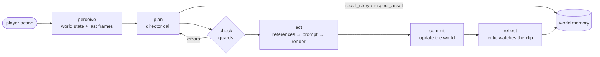

# Murea Agent

**English** | [中文](README_zh.md)

An open-world **video agent**, part of [Murea-InWorld](../README.md). You say what you do;
the agent decides what happens and films it as a short generated clip with sound on
the [Murea-Fast](../inference/README.md) inference service. Every beat continues from
the last one with the same people, places and visual style.

Each beat runs one fixed, inspectable loop:



| Phase | What happens | Code |
|---|---|---|
| perceive | read the world snapshot and the last frames of the previous clip | `murea_agent/loop.py` |
| plan | one structured call: what happens, where, who is in shot, dialogue, the video prompt, three next choices; may call memory tools first | `murea_agent/director/` |
| check | deterministic guards validate the action plan and physics; concrete errors go back to the director for a re-plan | `murea_agent/guards/` |
| act | stage the place and cast, draw missing reference images, lock the prompt for consistency, render the clip | `murea_agent/shot/`, `murea_agent/providers/` |
| commit | apply state and quest changes, save the clip on the story tree | `murea_agent/memory/` |
| reflect | after playback, a critic compares the real frames with the plan and fixes the world and the choices | `murea_agent/critic.py` |

The code owns the control flow; the model makes the decisions. Every step is
streamed as an event while it runs and saved with the clip, so the web UI's
**Agent** panel (and `python -m murea_agent`) shows exactly what the agent saw,
decided, checked and did.

## Quick start

You need [uv](https://docs.astral.sh/uv/), a key for text and images, and a running
[Murea-Fast](../inference/README.md) service for video:

```bash
git clone git@gitlab-server.hnminigames.fun:aura/Murea.git Murea-InWorld && cd Murea-InWorld/agent
cp .env.example .env          # fill in the two lines below
./run.sh                      # installs everything, then http://127.0.0.1:8080
```

```ini
GEMINI_API_KEY=...            # Google Gemini: text and images
MUREA_URL=http://<server>:<port>   # your Murea-Fast service, e.g. http://127.0.0.1:30260
```

The agent asks the service which model it runs (`GET /v1/models`) and writes its
requests to match. The released model is Murea-Fast; the agent also supports the
full Murea model, which has not been released yet. If you put an authenticating
proxy in front of the service, add `MUREA_API_KEY`. That is all; there is no config
file to edit. Without keys the app still opens, but cannot film, and the terminal
says which keys are missing.

With no world selected, type a short idea into the home input, such as "Explore the world of
the Dragon of Icespire Peak", and send it. The agent develops the setting, player role,
starting location, main objective and opening, creates the world, and starts filming its
first clip automatically. Input within an existing world remains an action in that world.
If world planning fails, the idea stays in the input for retry; it is never replaced by an
unrelated random world. Text/image credentials and a working video service are required.

On a single-GPU Murea-Fast service only 5-second clips have been tested. The service
reports its GPU count in `GET /v1/models`, and on one GPU the agent films every beat and
co-op round as a 5-second clip by itself; see [Clip length](#clip-length).

The service may run on the same machine, on another one, or behind an SSH tunnel
(`ssh -L 30260:127.0.0.1:30260 <gpu-host>`, then `MUREA_URL=http://127.0.0.1:30260`). The
agent never passes file paths: it sends reference images inline and uploads the
continuation prefix.

Other providers: instead of Gemini, set `OPENAI_API_KEY` for any OpenAI-compatible
server (then name its models in `config.yaml`), or `DASHSCOPE_API_KEY` for Alibaba Cloud
Model Studio (DeepSeek for text, Qwen-Image for images). Everything else (models, clip length, language, co-op
mode) is optional, in a `config.yaml` copied from
[`config.example.yaml`](config.example.yaml).

With Docker: `docker compose up --build` (reads the same `.env`). The page is published
on `127.0.0.1:8080` only. Inside the container `127.0.0.1` is the container itself, so a
Murea-Fast service (or SSH tunnel) on the same machine is
`MUREA_URL=http://host.docker.internal:30260`.

### In the terminal

```bash
.venv/bin/python -m murea_agent "I step into the inn and look around."
```

Example output (abridged; the times depend on the hardware):

```
  ◉ perceive observe             0.0s  here=Inn, beats=3, frames=4
  ✎ plan     recall_story        0.0s  args={'query': 'brass key'}
  ✎ plan     director            3.1s  beat=Mira shows the key to the keeper, place=Inn
  ✓ check    action_plan         0.0s  replanned=False
  ✓ check    motion_plan         0.0s  phase=engage, relation_change=contact
  ▶ act      write_prompt        0.0s  source=director
  ▶ act      render_clip        38.9s  model=murea, seconds=10, references=3
  ■ commit   update_world        0.1s  objective=Find out who forged the key
```

The clip path, the narration and three suggested actions follow.

### From Python

```python
from murea_agent import MureaAgent

agent = MureaAgent()
world = agent.create_world(title="Rainy Harbour", setting="A harbour town on a stormy night.")

for event in agent.stream(world, "I step into the inn and look around."):
    if event["type"] == "step" and event["status"] == "done":
        print(event["phase"], event["name"], event["data"])
    elif event["type"] == "done":
        clip = event["node"]

agent.reflect(world)  # let the critic check the clip against the plan
```

`MureaAgent` also has `continue_story`, `plan_ahead`, `regenerate` and `undo`.
See [`examples/play.py`](examples/play.py).

## Co-op mode

2–4 players share a room: each player brings a character, everyone submits an
action, and one shared clip films the round. Co-op runs in English or Chinese
(`agent.language`) on the same Murea service.

Co-op is a server-wide mode, not a button in the page. To turn it on:

1. Copy the example configuration (skip if you already have a `config.yaml`):

   ```bash
   cp config.example.yaml config.yaml
   ```

2. In `config.yaml`, change `mode: single` to `mode: coop`.
3. Restart the agent (stop `./run.sh` with Ctrl-C and start it again). The page
   now opens the co-op lobby instead of the single-player stage.

In the lobby:

- **Local co-op**: you control both characters on one page. Use it to try the mode
  alone; it needs no invite and no second account.
- **Online room**: 2–4 players, each controlling their own character. The host can
  add AI teammates, played by the language model (`coop.ai_mode`). Other players join with the room code or
  an invite link. The link uses the address you opened the page with; set `coop.public_url`
  when the others reach the agent at a different address.
  By default the agent listens on `127.0.0.1` only, so players on other machines
  also need `server.host` set accordingly; read [SECURITY.md](../SECURITY.md)
  before exposing it.

Rooms are stored in `data/coop/`, apart from single-player worlds. Set
`mode: single` and restart to go back; your single-player worlds are unchanged.

**Round length.** A round is one clip of 6–15 seconds (`coop.min_seconds` /
`coop.max_seconds`), chosen from the time the actions need: independent actions run
in parallel, dependent ones add up. The opening clip is 6 seconds
(`coop.opening_seconds`). Unlike single-player, a round is never split into several
clips, so a round needing more than `coop.max_seconds` is compressed into it; keep
each player's action to what fits. The limits are the same as for single-player (see
[Clip length](#clip-length)).

**With Murea-Fast:**

- The prompt is fitted to the 1,024 text tokens Murea-Fast reads, as it is actually
  sent (a continuation sends only the shot prose). Optional descriptions are removed
  first; a player's action is never cut. If a round still does not fit, it is refused
  with a request to shorten the actions.
- `coop.speculative_video: true` (the default) films the suggested actions while
  players are still deciding: one extra clip per round on the GPU.

The co-op room lives in [`murea_agent/coop/`](murea_agent/coop/); design notes:
[`docs/coop.md`](docs/coop.md).

## How the agent works

**Memory is pictures, not words.** Every character, creature, object and place
is a reference image plus a locked description. When the story returns to the
meeting room, the agent sends that room's image to the video model; nothing
depends on the language model remembering what it looked like.

| Memory | Keeps consistent | Where |
|---|---|---|
| assets | how people, things and places look | `World.subjects`, `World.places` |
| visual style | the art direction of the whole world | `World.visual_style` |
| dynamic state | clothes, injuries, props, mood, weather | `state` on each asset, snapshot per clip |
| map | which places connect | `World.place_links` |
| quests | the mainline, its phase, side quests | `World.quests` |
| story | the plot, as a tree of clips | `World.nodes`, `World.history` |

**The director reads a window, and recalls the rest.** Only the most recent
`agent.history_window` messages of the story are sent each beat. Once the
story is longer, the director is offered two tools, `recall_story` and
`inspect_asset`, and looks up older events itself instead of carrying the
whole story in every prompt ([`murea_agent/tools/recall.py`](murea_agent/tools/recall.py)).

**Guards, not hopes.** The director writes a structured motion plan (one
relation change per beat: approach, contact, enter, sit, pick up...). Guards
check it against the last frame and the beat length; the video prompt is then
locked so the shot keeps every reference, the speakers' voices and the
world's style. When a check fails, the error goes back to the director.

**Long actions become plans.** "I pack up, go downstairs and cross the street"
is several clips. The director plays the first and queues the rest; the
agent continues on its own until the goal is reached or the player
interrupts.

**Continue or cut.** In the same space a beat continues from the previous
clip; in a new space it starts from that place's reference image.

**Reflection.** The critic looks at the rendered frames, notices what really
happened (an item picked up, a character who appeared, a goal reached) and
corrects the world and the suggested choices before the player picks one.

## Extending

**Add a director tool.** Tools are plain functions with a JSON schema; the
director can call them before it answers, and each call shows up in the trace.

```python
from murea_agent.tools import tool


@tool(
    "weather_report",
    "Current weather of a place.",
    {"place": {"type": "string"}},
    required=("place",),
    for_director=True,
)
def weather_report(world, place):
    return world.places.get(place, {}).get("state", {}).get("weather", "unknown")
```

**Use another model.** `llm.provider: openai` talks to any OpenAI-compatible
endpoint (OpenAI, vLLM, SGLang...); endpoints without JSON-schema output fall
back to JSON mode automatically. Tested end to end in English and Chinese, single
player and co-op: DashScope (`deepseek-v4.1-flash` + `qwen-image-2.0`) with Murea. The video client lives in [`murea_agent/providers/video/`](murea_agent/providers/video/);
another service can be added by implementing `VideoProvider` (`base.py`) and registering it in `__init__.py`.

**Change the prompts.** The director's prompt is
[`murea_agent/director/prompts/agent.md`](murea_agent/director/prompts/agent.md); the rules for
writing the video prompt are shared by the director and the rewriter in
[`video_prompt.md`](murea_agent/director/prompts/video_prompt.md).

## Configuration

Keys go in `.env`. Everything else is optional: without a `config.yaml` the
defaults in [`config.example.yaml`](config.example.yaml) apply; copy it to
`config.yaml` to change them. Values may reference environment variables as
`${NAME}`.

| Section | What it controls |
|---|---|
| `server` | host, port, data directory |
| `llm` | which provider runs the director (`auto` picks from the keys), which model does which job |
| `openai` / `gemini` | base URLs (a compatible server or proxy) |
| `image` | the reference-image model (`auto` follows the language model) |
| `video` | the Murea address and clip length (see below) |
| `tts` | optional narration voice ([OmniVoice](https://github.com/k2-fsa/OmniVoice)) |
| `agent` | story language, history window, director tools, option prefetch |

Within one place each beat continues from the previous clip (same machine or
remote service); a new place starts again from the reference images.

### Clip length

The director gives each beat 6–10 seconds (`video.min_seconds` / `video.max_seconds`).
An action that needs longer is split into several beats, which the agent films one
after another.

| | Murea-Fast |
|---|---|
| Longest clip | 20 s, the model's positional range; a continuation's 17-frame prefix counts toward it |
| On a single-GPU service | 5 s, the only length tested on one GPU |
| Default maximum in single-player / co-op | 10 s / 15 s |

Values above the longest clip are capped to it, so on one GPU every beat and co-op round is
5 seconds long whatever `config.yaml` says. Longer clips take longer to film: Murea-Fast on
four H20 GPUs needs 3.4–4 seconds of inference time per second of video (see
[Performance](../inference/docs/performance.md#clip-length)). The four-GPU measurements
used 141 GB H20s; there, clips of 10 seconds or more reserved more than 96 GB per GPU, so on
96 GB GPUs keep `video.max_seconds` and `coop.max_seconds` below 10.

`agent.language` (`en` / `zh`) sets the language of the story and the UI.
Video prompts are always English; only spoken lines use the story language.

**Cost per beat** (Gemini): one director call (~10k input tokens, mostly the
cacheable system prompt; ~1.3k output), about two short audit calls, 0–2
reference images when something new appears, one clip, and one critic call after playback. With
Murea-Fast on four H20s the clip takes about 17 s of inference time for 5 seconds and 35 s for
10 seconds; on one H20, 44–101 s for 5 seconds.

Each reference image adds tokens to every step of Murea-Fast in proportion to its pixel count
(see [Reference image size](../inference/docs/performance.md#reference-image-size)). Before
sending, the agent therefore scales each reference down to at most about 1.8 megapixels, the
size it draws them at, and crops the plain backdrop around a drawn character or object; with
three 12-megapixel photos a 5-second clip took 17.4 s instead of 58.5 s on four H20s. Places
and photos with a real background are not cropped, and the files you upload stay as they are.

## Project layout

```
murea_agent/          the agent (a Python package, no web dependencies)
  agent.py            MureaAgent: the public API
  loop.py             the turn loop: perceive → plan → check → act → commit
  events.py           steps, events, the per-clip trace
  director/           the planning model: prompts, schema, prefetch
  guards/             plan checks and re-planning
  shot/               reference images, voices, the video prompt
  critic.py           reflect: compare the clip with the plan
  memory/             the world: assets, map, state, quests, story tree
  tools/              tool registry and the director's memory tools
  providers/          LLM, image, video and TTS clients
  coop/               co-op rooms (mode: coop)
app/                  FastAPI server: streams agent events to the UI
frontend/             React + Vite UI (the Agent panel shows the trace)
tests/                offline tests: python tests/run_all.py
```

## Development

```bash
.venv/bin/python tests/run_all.py     # offline tests, no API calls
cd frontend && npm run dev            # UI with hot reload on :5173
```

Data (worlds, clips, images) is written to `data/` and is not versioned.
