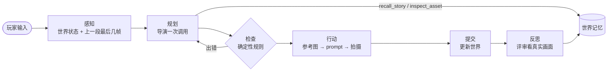

# Murea Agent

[English](README.md) | **中文**

一个开放世界**视频 Agent**，是 [InWorld](../README_zh.md) 的一部分。你说想做什么，Agent 决定接下来发生什么，并用 [Murea-Fast](../inference/README_zh.md) 推理服务把这一拍拍成一段带声音的生成视频。每一拍都接着上一拍往下演：人物、地点、画风保持一致。

每一拍都走同一个固定、可追踪的循环：



| 阶段 | 做什么 | 代码 |
|---|---|---|
| 感知 | 读世界快照和上一段视频的最后几帧 | `murea_agent/loop.py` |
| 规划 | 一次结构化调用：发生什么、在哪、谁出镜、台词、视频 prompt、三个推荐选项；需要时先调用记忆工具 | `murea_agent/director/` |
| 检查 | 确定性规则校验动作计划和物理关系，错误原样交回导演重写 | `murea_agent/guards/` |
| 行动 | 布景选角、画缺的参考图、锁定一致性、拍视频 | `murea_agent/shot/`、`murea_agent/providers/` |
| 提交 | 写入状态和任务变化，把这一段挂到剧情树上 | `murea_agent/memory/` |
| 反思 | 播放后由评审对照真实画面和计划，修正世界和选项 | `murea_agent/critic.py` |

控制流由代码掌握，决策由模型做。每一步在运行时实时推送，并随视频一起保存，网页上的 **Agent** 面板（以及 `python -m murea_agent`）能看到 Agent 这一拍看到了什么、决定了什么、检查了什么、做了什么。

## 快速开始

需要装好 [uv](https://docs.astral.sh/uv/)，准备一个文字和出图用的 key，再起一个 [Murea-Fast](../inference/README_zh.md) 视频服务：

```bash
git clone https://github.com/sjsjhsu/InWorld && cd InWorld/agent
cp .env.example .env          # 填好下面两行
./run.sh                      # 自动装好依赖，然后打开 http://127.0.0.1:8080
```

```ini
DASHSCOPE_API_KEY=...         # 阿里云百炼：DeepSeek + Qwen-Image
MUREA_URL=http://<服务器>:<端口>   # 你的 Murea-Fast 服务，例如 http://127.0.0.1:30260
```

Agent 会向服务查询它运行的是哪个模型（`GET /v1/models`），并按对应格式发请求。已发布的模型是 Murea-Fast；Agent 也支持尚未发布的完整版 Murea 模型。如果在服务前面加了带鉴权的反向代理，再填 `MUREA_API_KEY`。

服务可以和 Agent 在同一台机器上，也可以在别的机器上，或通过 SSH 隧道访问（`ssh -L 30260:127.0.0.1:30260 <GPU 主机>`，再设 `MUREA_URL=http://127.0.0.1:30260`）。Agent 从不传文件路径：参考图直接放在请求里发送，续写前缀以上传方式发送。

就这些，不用改任何配置文件。一个 key 都没填也能打开，只是拍不了视频，终端会提示缺哪些 key。

还没有世界时，直接在主页输入一句想法，例如“去冰塔峰之龙的世界探险”，然后发送。
Agent 会据此补全世界观、玩家身份、起始地点、主线目标和开场，创建世界后自动开始拍第一段。
已有世界里的输入仍是当前角色的行动。完善世界失败时会保留原句，供你重试，不会换成无关的随机世界。这需要文字和出图的 key，以及能用的视频服务。

单卡 Murea-Fast 服务只测试过 5 秒片段。服务会在 `GET /v1/models` 中报告卡数，单卡时 Agent 会自动把每一拍和双人模式的每一轮都拍成 5 秒片段，见[片段时长](#片段时长)。

换别的模型：不填百炼、改填 `GEMINI_API_KEY`（文字和出图都用 Gemini），或者 `OPENAI_API_KEY`（任何 OpenAI 兼容接口，需要在 `config.yaml` 里写上模型名）。其余设置（模型、片段时长、故事语言、双人模式）都是可选的，复制 [`config.example.yaml`](config.example.yaml) 为 `config.yaml` 再改。

也可以用 Docker：`docker compose up --build`（同样读 `.env`）。页面只发布在 `127.0.0.1:8080` 上。容器里的 `127.0.0.1` 指容器自己，所以同一台机器上的 Murea-Fast 服务（或 SSH 隧道）要写成 `MUREA_URL=http://host.docker.internal:30260`。

### 在终端里玩

```bash
.venv/bin/python -m murea_agent "我推门走进客栈，四处看看。"
```

示例输出（节选，耗时取决于硬件）：

```
  ◉ perceive observe             0.0s  here=客栈, beats=3, frames=4
  ✎ plan     recall_story        0.0s  args={'query': '黄铜钥匙'}
  ✎ plan     director            3.1s  beat=米拉把钥匙拿给掌柜看, place=客栈
  ✓ check    action_plan         0.0s  replanned=False
  ✓ check    motion_plan         0.0s  phase=engage, relation_change=contact
  ▶ act      write_prompt        0.0s  source=director
  ▶ act      render_clip        38.9s  model=murea, seconds=10, references=3
  ■ commit   update_world        0.1s  objective=查出是谁伪造了钥匙
```

每一步 Agent 做了什么会实时打印出来，然后是视频路径、旁白和三个选项。

### 从 Python 调用

```python
from murea_agent import MureaAgent

agent = MureaAgent()
world = agent.create_world(title="雨夜港口", setting="暴雨夜里的海港小镇。")

for event in agent.stream(world, "我走进客栈，四处看看。"):
    if event["type"] == "step" and event["status"] == "done":
        print(event["phase"], event["name"], event["data"])
    elif event["type"] == "done":
        clip = event["node"]

agent.reflect(world)  # 播放后让评审对照画面检查
```

`MureaAgent` 还有 `continue_story`、`plan_ahead`、`regenerate`、`undo`。示例见 [`examples/play.py`](examples/play.py)。

## 双人模式

2–4 位玩家共用一个房间：每人带一个角色，各自提交一个动作，系统把这一轮拍成一段共享视频。双人模式同样支持中英文（`agent.language`），同样用 Murea 拍摄。

双人模式是整个服务的运行方式，网页上没有切换按钮。开启方法：

1. 复制示例配置（已有 `config.yaml` 的跳过这一步）：

   ```bash
   cp config.example.yaml config.yaml
   ```

2. 在 `config.yaml` 里把 `mode: single` 改成 `mode: coop`。
3. 重启 Agent（在运行 `./run.sh` 的终端按 Ctrl-C，再重新运行）。网页打开后显示双人大厅，不再是单人界面。

大厅里有两种房间：

- **本地双人调试**：一个人在同一页面上控制两个角色，不需要邀请别人，也不用切换账号，适合自己先试。
- **联机房间**：2–4 位玩家各自控制角色，房主可以加 AI 队友，由语言模型扮演（`coop.ai_mode`）。其他玩家用房间码或邀请链接加入。邀请链接使用你打开页面时的地址；如果其他玩家要通过另一个地址访问 Agent，请设置 `coop.public_url`。Agent 默认只监听 `127.0.0.1`，其他机器上的玩家还需要相应修改 `server.host`；对外开放前请先阅读 [SECURITY_zh.md](../SECURITY_zh.md)。

房间保存在 `data/coop/`，和单人世界分开存放。改回 `mode: single` 再重启即可回到单人模式，单人世界不受影响。

**每轮时长。** 每一轮拍一段 6–15 秒的视频（`coop.min_seconds` / `coop.max_seconds`），按动作需要的时间选定：互不依赖的动作同时进行，有先后依赖的动作时间相加。序章视频为 6 秒（`coop.opening_seconds`）。和单人模式不同，一轮不会拆成多段视频，需要超过 `coop.max_seconds` 的一轮会被压缩进去，所以每位玩家的动作请控制在一轮演得完的范围内。时长上限与单人模式相同（见[片段时长](#片段时长)）。

**使用 Murea-Fast 时：**

- 提示词按 Murea-Fast 能读取的 1024 个 token 控制长度，并且按实际发送的内容计算（续写时只发送镜头描述）。超长时先删去可选的描述，绝不删减玩家的动作；仍然装不下时，这一轮会被拒绝，并提示减少动作步骤。
- `coop.speculative_video: true`（默认开启）会在玩家还在选动作时先拍推荐动作的视频，每轮多占用一次 GPU。

代码在 [`murea_agent/coop/`](murea_agent/coop/)，设计说明见 [`docs/coop_zh.md`](docs/coop_zh.md)。

## Agent 是怎么工作的

**世界用图片记忆，而不是文字。** 每个角色、生物、物件、地点都是一张真实的参考图加一段锁定描述。剧情回到会议室时，Agent 把那间会议室的图发给视频模型，不依赖语言模型记得它长什么样。

| 记忆 | 保证什么一致 | 在哪 |
|---|---|---|
| 资产 | 人、物、地点的样子 | `World.subjects`、`World.places` |
| 视觉风格 | 整个世界的画风 | `World.visual_style` |
| 动态状态 | 服装、伤势、道具、情绪、天气 | 每个资产上的 `state`，每段一份快照 |
| 地图 | 哪些地点相通 | `World.place_links` |
| 任务 | 主线、阶段、支线 | `World.quests` |
| 剧情 | 情节，以剧情树保存 | `World.nodes`、`World.history` |

**导演只读最近一段，更早的自己去查。** 每拍只发最近 `agent.history_window` 条剧情。故事变长后，导演会拿到 `recall_story` 和 `inspect_asset` 两个工具，自己查以前的事件和资产，而不是每次都把整段故事塞进提示词（[`murea_agent/tools/recall.py`](murea_agent/tools/recall.py)）。

**靠规则兜底，不靠运气。** 导演写一份结构化的动作计划（每拍只允许一种关系变化：走近、接触、进入、坐下、拿起……）。规则对照上一段最后一帧和本拍时长检查它；视频 prompt 随后被锁定，保证每张参考图、说话人的音色和世界画风都在。检查不过，错误交回导演重写。

**长动作自动拆开。** "收拾东西下楼，穿过马路"是好几段。导演先拍第一段，剩下的排成计划，Agent 自己接着演，直到目标完成或玩家打断。

**续写还是切镜。** 同一个空间里接着上一段续写；换了地方就从新地点的参考图重新开一段。

**反思。** 评审看拍出来的画面，确认真实发生了什么（捡到东西、出现新角色、目标达成），在玩家选下一步之前修正世界和选项。

## 扩展

**加一个导演工具。** 工具就是带 JSON schema 的普通函数，导演在回答前可以调用，每次调用都会出现在轨迹里：

```python
from murea_agent.tools import tool


@tool(
    "weather_report",
    "某个地点当前的天气。",
    {"place": {"type": "string"}},
    required=("place",),
    for_director=True,
)
def weather_report(world, place):
    return world.places.get(place, {}).get("state", {}).get("weather", "unknown")
```

**换模型。** `llm.provider: openai` 可接任何 OpenAI 兼容接口（OpenAI、vLLM、SGLang 等）；不支持 JSON schema 约束的接口会自动退回 JSON 模式。已端到端验证（中英文、单人和双人）：百炼（`deepseek-v4.1-flash` + `qwen-image-2.0`）配 Murea。视频客户端在 [`murea_agent/providers/video/`](murea_agent/providers/video/)；要接别的服务，实现 `VideoProvider`（`base.py`）并在 `__init__.py` 里登记即可。

**改提示词。** 导演的提示词是 [`murea_agent/director/prompts/agent.md`](murea_agent/director/prompts/agent.md)；写视频 prompt 的规则由导演和改写器共用，在 [`video_prompt.md`](murea_agent/director/prompts/video_prompt.md)。

## 配置

key 放在 `.env`。其余都是可选的：没有 `config.yaml` 时使用 [`config.example.yaml`](config.example.yaml) 里的默认值，要改就复制成 `config.yaml`。值可以写成 `${NAME}` 引用环境变量。

| 分节 | 管什么 |
|---|---|
| `server` | 监听地址、端口、数据目录 |
| `llm` | 导演用哪家模型（`auto` 按填了哪个 key 选），各个角色用哪个模型 |
| `openai` / `gemini` | 接口地址（兼容服务或代理） |
| `image` | 参考图模型（`auto` 跟随语言模型） |
| `video` | Murea 地址、片段时长（见下文） |
| `tts` | 可选的旁白配音（[OmniVoice](https://github.com/k2-fsa/OmniVoice)） |
| `agent` | 故事语言、剧情窗口、导演工具、选项预推演 |

同一场景里每一拍都从上一段接着拍（服务在同机或远程都一样）；换到新场景时重新凭参考图生成。

### 片段时长

导演给每一拍规划 6–10 秒（`video.min_seconds` / `video.max_seconds`）。需要更长时间的动作会拆成几拍，由 Agent 依次拍完。

| | Murea-Fast |
|---|---|
| 单段最长 | 20 秒，即模型的位置编码范围；续写时 17 帧前缀也计入其中 |
| 单卡服务 | 5 秒，单卡只测试过这个长度 |
| 单人 / 双人模式默认上限 | 10 秒 / 15 秒 |

超过单段最长时长的设置会被限制到该时长，所以单卡时无论 `config.yaml` 怎么设，每一拍和每一轮都是 5 秒。片段越长，拍摄越久：Murea-Fast 在 4 张 H20 上每秒视频约需 3.4–4 秒推理时间（见[性能](../inference/docs/performance_zh.md#片段时长)）。4 卡实测用的是 141 GB 的 H20，10 秒及以上的片段每张卡占用超过 96 GB，所以在 96 GB 的 GPU 上请把 `video.max_seconds` 和 `coop.max_seconds` 设为 10 以下。

`agent.language`（`en` / `zh`）决定故事和界面的语言。视频 prompt 始终是英文，只有其中的台词用故事语言。

**每一拍的开销**（Gemini）：一次导演调用（输入约 1 万 token，大部分是可缓存的系统提示词；输出约 1300），约两次短的审查调用，出现新东西时 0–2 张参考图，一段视频，播放后一次评审调用。Murea-Fast 在 4 张 H20 上拍 5 秒片段约需 17 秒推理时间、10 秒片段约 35 秒；单张 H20 上 5 秒片段约 44–101 秒。

每张参考图都会按像素数给 Murea-Fast 的每一步增加 token（见[参考图尺寸](../inference/docs/performance_zh.md#参考图尺寸)）。因此 Agent 在发送前会把每张参考图缩小到最多约 180 万像素（即它自己出图的尺寸），并裁掉画出来的角色或物件周围的纯色背景：在 4 张 H20 上，用三张 1200 万像素的照片拍 5 秒片段，耗时从 58.5 秒降到 17.4 秒。有实际背景的地点图和照片不会被裁剪，你上传的文件保持原样。

## 目录结构

```
murea_agent/          Agent 本体（Python 包，不依赖网页）
  agent.py            MureaAgent：对外接口
  loop.py             回合循环：感知 → 规划 → 检查 → 行动 → 提交
  events.py           步骤、事件、每段的轨迹
  director/           导演：提示词、输出结构、预推演
  guards/             计划检查与重新规划
  shot/               参考图、音色、视频 prompt
  critic.py           反思：对照画面和计划
  memory/             世界：资产、地图、状态、任务、剧情树
  tools/              工具注册表和导演的记忆工具
  providers/          语言模型、生图、视频、配音客户端
  coop/               双人房间（mode: coop）
app/                  FastAPI 服务：把 Agent 事件推给前端
frontend/             React + Vite 前端（Agent 面板显示轨迹）
tests/                离线测试：python tests/run_all.py
```

## 开发

```bash
.venv/bin/python tests/run_all.py     # 离线测试，不调用任何接口
cd frontend && npm run dev            # 前端热更新，:5173
```

运行数据（世界、视频、图片）写在 `data/`，不进版本库。
